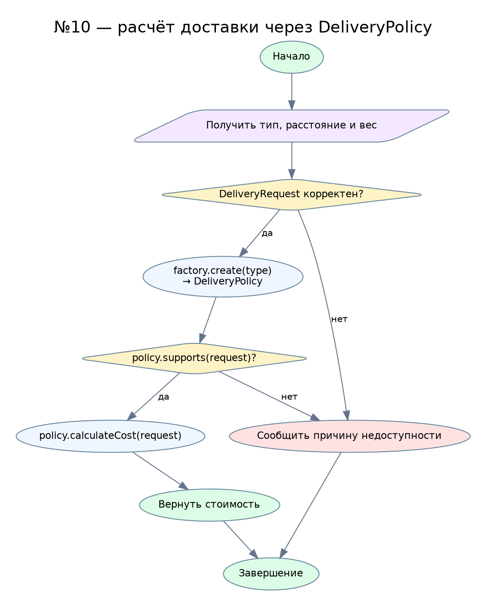
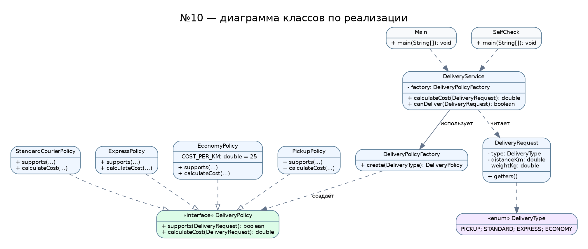

# Диаграммы практической №10: Доставка через стратегии

- `activity.png` — готовая Activity-диаграмма.
- `classes.png` — готовая UML-подобная диаграмма классов.
- `activity.svg` и `classes.svg` — векторные версии тех же схем.
- `activity.dot` и `classes.dot` — редактируемые исходники Graphviz.

Диаграммы построены по Java-кодам, введённым в переписке, и отражают фактические имена классов и методов (а не несуществующие классы из неполного шаблона).
